# Outsourced ITAM — Official Presenter Guide & Talk Track

**Document Purpose**: Internal IT Leadership & Executive Presentation Guide  
**Slide Deck**: [Outsourced_ITAM_Internal_Product_Showcase.pptx](file:///f:/Outsourced-IT/Sample%20Outsourced%20ITAM/Outsourced_ITAM_Internal_Product_Showcase.pptx)  
**Safety Backup Deck**: [Outsourced_ITAM_Internal_Product_Showcase_original_backup.pptx](file:///f:/Outsourced-IT/Sample%20Outsourced%20ITAM/Outsourced_ITAM_Internal_Product_Showcase_original_backup.pptx)  
**Interactive Demo URL**: `http://localhost:3000` (or `npm run preview` on port 4173)  
**Governing Standard**: SOP `OPH-FA-PRO-0001 R1` (Asset Lifecycle & Custody Governance)  
**Recommended Showcase Timing**: 12–15 Minutes Presentation + 5–10 Minutes Live Interactive Walkthrough  

---

  
   
  <strong>Outsourced ITAM — Operational Asset Lifecycle & Custody Platform</strong>

---

## 1. Executive Presentation Agenda & Structure

| Section | Slides | Focus & Objective | Target Duration |
| :--- | :--- | :--- | :--- |
| **Part 1: The Vision & Core Purpose** | Slides 1–2 | Introducing Outsourced ITAM, brand identity, and the single operational view. | 2–3 Minutes |
| **Part 2: Operational Architecture** | Slides 3–4 | 8-stage physical lifecycle model and 9 standardized SOP workspaces. | 3 Minutes |
| **Part 3: Live Day-to-Day Capabilities** | Slides 5–6 | Unified Asset Registry, Mobile QR Audits, and Guided Workflows. | 4 Minutes |
| **Part 4: Governance & Boundaries** | Slides 7–8 | RBAC matrix, Document Vault, and clear HubSpot/NetSuite boundaries. | 3 Minutes |
| **Part 5: Roadmap & Live Demo Story** | Slides 9–10 | Phased 6-stage engineering rollout and 6-step single-asset demo walkthrough. | 3 Minutes |

---

## 2. Slide-by-Slide Script & Visual Previews

---

### Slide 1 — Title & Cover

#### Product Visual Preview:

  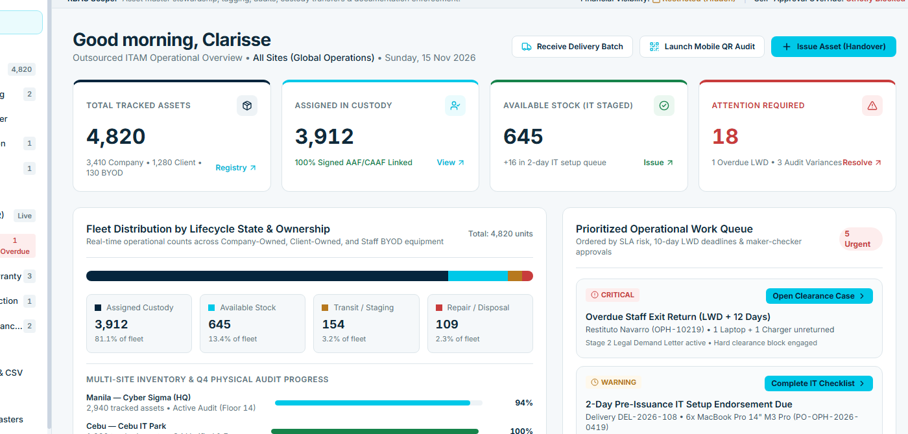
   
  <em>Figure 1: Live Demo Platform Preview Card featured on Slide 1 — <a href="file:///f:/Outsourced-IT/Sample%20Outsourced%20ITAM/screenshots/deck_assets/s1_hero.png">View Full Image</a></em>

- **Visual Display**: Official Outsourced cyan brand logo, floating *"Live Demo Platform Preview"* card on the right dark navy panel, and badge: `DEMO PLATFORM SHOWCASE • INTERACTIVE SYSTEM BUILT TO SOP OPH-FA-PRO-0001 R1`.
- **Core Message**: Establish that this is a purpose-built, governed internal ITAM platform adhering to standard operating procedures, backed by a working interactive prototype.

#### Word-for-Word Talk Track:
> "Good morning, everyone.
>
> Today, I am proud to walk you through **Outsourced ITAM** — our proposed internal IT Asset Lifecycle, Custody, and Accountability platform.
>
> In high-growth organizations, physical IT assets often become fragmented across disparate spreadsheets, email threads, and ticketing queues. When an audit occurs, or when an employee offboards, IT, HR, and Finance teams are left reconciling outdated Excel files.
>
> Outsourced ITAM solves this at the foundation. It establishes an authoritative operational system of record that tracks physical equipment from initial delivery and tagging, through custody transfers, maintenance, and mobile audits, all the way to secure disposal.
>
> What you see in this deck is not conceptual wireframes. Every screen featured today has been captured directly from our working, interactive demo platform built to the official `OPH-FA-PRO-0001 R1` SOP.
>
> Let's look at the primary operational challenge this platform solves."

*Transition*: *"Let's examine how Outsourced ITAM replaces disconnected tracking with a single operational view."*

---

### Slide 2 — 01 / Product Overview (One Operational View)

#### Product Visual Preview:

  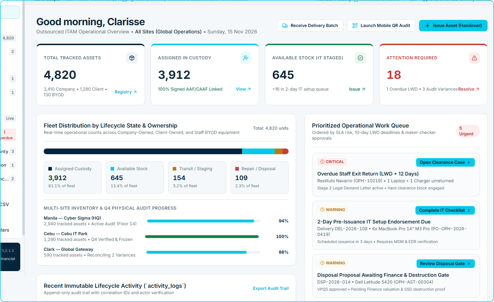
   
  <em>Figure 2: Live Executive Operational Dashboard (4,820 Tracked Assets across Manila, Cebu & Clark) — <a href="file:///f:/Outsourced-IT/Sample%20Outsourced%20ITAM/screenshots/dashboard.png">View Full Dashboard</a></em>

- **Visual Display**: Live [Executive Operational Dashboard](file:///f:/Outsourced-IT/Sample%20Outsourced%20ITAM/src/features/dashboard/DashboardModule.tsx) snip on the left (showing 4,820 tracked assets, fleet distribution bar, 2-day pre-issuance setup queue, and urgent SLA items) alongside the four core operational pillars on the right.
- **Core Message**: The platform brings asset information, custody, operational work queues, and historical records together into one pane of glass.

#### Key Operational Pillars:
1. **Know what exists**: Real-time fleet registry across company-owned, client-consigned, and approved BYOD hardware.
2. **Know who has it**: Explicit employee custody backed by legally binding signed AAF/CAAF agreements.
3. **Know what needs action**: Proactive SLA work queues for pending IT staging, overdue staff returns, and destination receipt gates.
4. **Know what happened**: Tamper-evident, immutable lifecycle history tying every transition to an actor and evidence document.

#### Word-for-Word Talk Track:
> "On this slide, you are looking at our actual **Executive Operational Dashboard**.
>
> As shown on the live dashboard card, our operational fleet spans **4,820 tracked assets** across our Manila Cyber Sigma, Cebu IT Park, and Clark Global Gateway facilities.
>
> The platform organizes IT operations around four fundamental questions:
> - **First, Know What Exists**: A searchable, multi-site registry showing exact model specs, location, and decoupled lifecycle status versus physical condition.
> - **Second, Know Who Has It**: Every deployed machine is tied to an employee ID, site seat location, and verified signed custody agreement.
> - **Third, Know What Needs Action**: Notice the **Prioritized Work Queue** on the right side of the dashboard. Instead of waiting for emails, the system highlights urgent operational actions: equipment awaiting the mandatory 2-day IT pre-issuance staging gate, overdue offboarding returns exceeding the 10-day LWD deadline, and disposal proposals awaiting dual approvals.
> - **Fourth, Know What Happened**: Every movement, repair, transfer, and status change generates an immutable audit record with correlation IDs.
>
> Now, let’s see how an asset flows through this lifecycle from arrival to retirement."

*Transition*: *"Let's trace the complete 8-stage lifecycle of an asset."*

---

### Slide 3 — 02 / Lifecycle View (Arrival to Retirement)
- **Visual Display**: The 8-stage sequential lifecycle chevron: `01 Receive` → `02 Tag` → `03 Prepare` → `04 Issue` → `05 Support` → `06 Verify` → `07 Return` → `08 Retire`.
- **Core Message**: Physical IT hardware moves through a controlled lifecycle where every state change represents an accountable physical action, not just a dropdown edit.

#### The 8 Controlled Stages:
1. **Receive**: Equipment arrives from suppliers (e.g. Power Mac Center Enterprise, Dell). IT verifies the purchase order, packaging, and quantity.
2. **Tag**: A unique asset tag (`OPH-AST-XXXXX`) is assigned and a serialized QR code label is generated.
3. **Prepare**: Equipment enters our mandatory **2-Day Pre-Issuance IT Staging Gate** (`DEL-03`) for OS imaging, encryption verification (FileVault 2 or BitLocker), and hardware inspection.
4. **Issue**: Custody is formally transferred to the staff member upon signing the appropriate accountability form (AAF for company-owned, CAAF for client-owned).
5. **Support**: Handles defect logging, RMA vendor repairs, warranty coverage, and inter-site movements.
6. **Verify**: Quarterly physical inventory audits reconcile real-world floor equipment against system records.
7. **Return**: Governed intake upon staff resignation, project roll-off, or hardware refresh.
8. **Retire**: Formal maker-checker approvals and data sanitization according to NIST SP 800-88 before physical destruction or donation.

#### Word-for-Word Talk Track:
> "This is the overall lifecycle of an asset.
>
> Let's take a laptop as an example. When a new laptop arrives, it is received, inspected, and assigned a unique asset tag.
>
> It then enters our **2-day pre-issuance IT setup queue** where technicians install the standard operating environment, confirm hardware encryption, and verify BIOS passwords before issuance.
>
> Once issued, its custody is legally bound via a signed accountability form. If the laptop develops a fault, it moves into maintenance. If the staff member resigns, it triggers a 10-day clearance countdown.
>
> When the asset reaches end-of-life, it undergoes certified data sanitization and dual-authorization disposal.
>
> The critical rule here is: **Every lifecycle change is tied to an accountable action — not just a status edit.**"

*Transition*: *"To execute these 8 stages seamlessly, the platform provides nine specialized operational workspaces."*

---

### Slide 4 — 03 / Capability Map (The Operational Workspaces)
- **Visual Display**: The 9 SOP workspace cards matching the application's persistent navigation sidebar:
  - `01 Asset Registry`
  - `02 Delivery & Tagging`
  - `03 Issuance & Handover`
  - `04 Returns & Clearance`
  - `05 Transfers`
  - `06 Physical Audits`
  - `07 Maintenance & Warranty`
  - `08 Disposal & Retirement`
  - `09 Incidents & Discrepancies`
- **Core Message**: Every SOP process is given a dedicated workspace while sharing common database models, RBAC rules, and audit logging.

#### Word-for-Word Talk Track:
> "These are our nine primary operational workspaces.
>
> Rather than a generic database, each module addresses a specific standard operating procedure:
> - **Asset Registry**: Central database of all active, staging, and retired equipment.
> - **Delivery & Tagging**: Intake logging, PO reconciliation, and QR label batch generation.
> - **Issuance & Handover**: The wizard that guides IT staff through request validation, setup checklists, and signed document upload.
> - **Returns & Clearance**: Coordinated offboarding with HR to eliminate unreturned laptops.
> - **Transfers**: Dual-custodian transit tracking between Manila, Cebu, and Clark.
> - **Physical Audits**: Fast mobile QR scanning with immediate variance classification.
> - **Maintenance & Warranty**: Vendor RMA tracking and hardware downtime history.
> - **Disposal & Retirement**: Secure decommissioning with storage serial validation and destruction certificate archival.
> - **Incidents & Discrepancies**: Investigation workflows for lost, damaged, or unverified hardware.
>
> All nine workspaces are directly accessible through our sidebar navigation and backed by shared document vaulting, approvals, and reporting."

*Transition*: *"Now, let’s look at two high-frequency workspaces our IT team will use every single day."*

---

### Slide 5 — 04 / Day-to-Day Experience (Registry & Field Verification)

#### Product Visual Previews:

  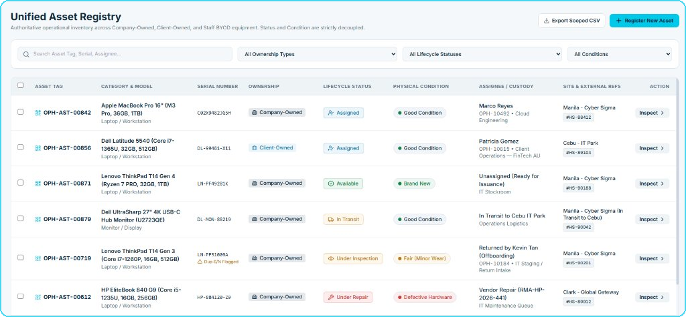
   
  <em>Figure 3: Left Panel on Slide 5 — Unified Asset Registry (Decoupled Status vs. Condition) — <a href="file:///f:/Outsourced-IT/Sample%20Outsourced%20ITAM/screenshots/registry.png">View Full Registry</a></em>

  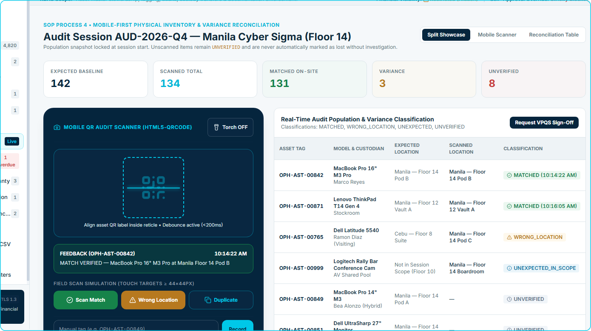
   
  <em>Figure 4: Right Panel on Slide 5 — Mobile QR Physical Audit Workspace & Scanner — <a href="file:///f:/Outsourced-IT/Sample%20Outsourced%20ITAM/screenshots/audits.png">View Full Audit Workspace</a></em>

- **Visual Display**: Symmetrical side-by-side screenshots captured directly from the live platform:
  - **Left Panel**: [Unified Asset Registry](file:///f:/Outsourced-IT/Sample%20Outsourced%20ITAM/src/features/assets/AssetRegistryModule.tsx) with search bar, filter dropdowns, and live table rows (`OPH-AST-00842`, `OPH-AST-00856`, etc.).
  - **Right Panel**: [Physical Audit & Mobile QR Scanner](file:///f:/Outsourced-IT/Sample%20Outsourced%20ITAM/src/features/audits/PhysicalAuditModule.tsx) displaying live camera viewfinder, match verification banner, and Q4 floor progress.
  - **Footer Caption**: `Captured directly from the interactive Outsourced ITAM demo platform.`
- **Core Message**: Rapid search and filtering for office staff, paired with mobile-first camera scanning for field technicians.

#### Word-for-Word Talk Track:
> "Slide 5 showcases the core day-to-day user experience.
>
> **On the left is our Unified Asset Registry:**
> - Notice how cleanly the data is organized. We strictly decouple **Lifecycle Status** (such as *Assigned*, *Available*, *In-Transit*, or *Under Inspection*) from **Physical Condition** (*Brand New*, *Good*, *Fair*, *Defective*). An asset can be *Assigned* while in *Fair* condition, or *In Stock* but marked *Defective*.
> - We also partition hardware by ownership: **Company-Owned (Outsourced)**, **Client-Owned (Consigned)**, and **Staff BYOD**. Each row references the associated HubSpot onboarding ticket.
> - Filter controls allow instant segmentation by site, ownership, and condition, with scoped CSV export.
>
> **On the right is our Mobile QR Audit Workspace:**
> - Rather than printing out hundreds of spreadsheet pages and ticking off boxes with a pen, IT custodians take a tablet or smartphone into the stockroom or production floor.
> - The integrated camera scanner reads the QR code and instantly provides audio-visual feedback:
>   - **Green Match**: Device is in the correct room and custody.
>   - **Amber Warning**: Asset scanned belongs to another floor or site.
>   - **Red Alert**: Unrecognized asset or duplicate serial number.
> - Unscanned items are never automatically assumed missing; they enter an audit variance queue for systematic physical investigation."

*Transition*: *"Now let's examine how the platform enforces real-world custody through guided workflows."*

---

### Slide 6 — 05 / Workflow Examples (Guided Actions)

#### Product Visual Previews:

  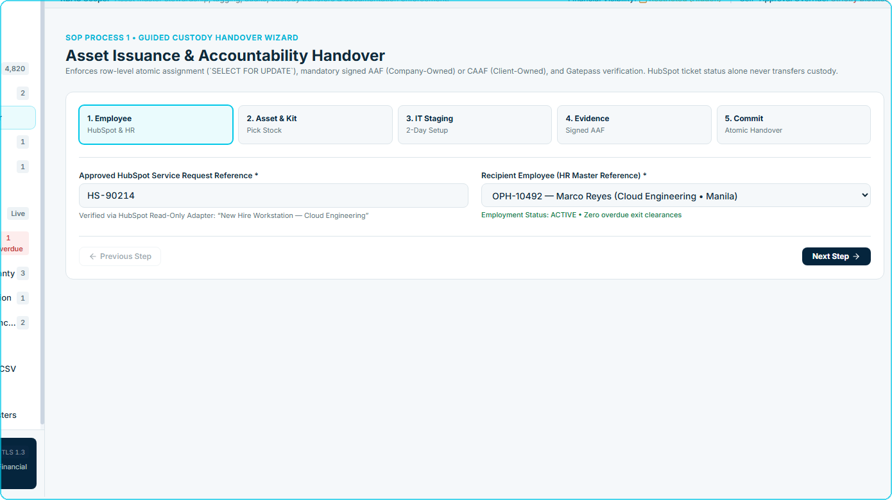
  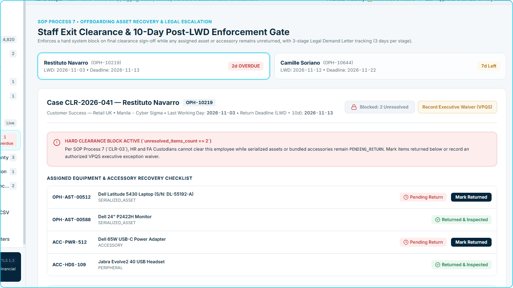
   
  <em>Figure 5: Slide 6 Workflow Insets — Issuance Wizard with Signed AAF (Left) & Staff Exit Clearance Case (Right)</em>

- **Visual Display**: Three operational workflow cards with live platform insets:
  1. `IT + FA Custodian`: **Issue an Asset** (with Issuance Wizard screenshot & signed AAF upload).
  2. `IT + HR + Legal`: **Return & Clear** (with 10-day LWD Clearance countdown & legal hold flag).
  3. `Sending + Receiving Custodian`: **Transfer an Asset** (with dual-custodian dispatch & destination receipt).
  - **Footer Principle**: `Control principle: the record changes when the real-world handover is confirmed — not merely when a request is updated.`
- **Core Message**: Transactions cannot be completed with casual status edits; they require sequential physical validation and uploaded evidence.

#### Word-for-Word Talk Track:
> "Slide 6 illustrates our guided transaction workflows. Spreadsheets fail because anyone can edit a cell without performing the physical step. Outsourced ITAM prevents this with guided step enforcement:
>
> **1. Asset Issuance (DEL-03 & ISS-01):**
> - IT validates the approved request and verifies the 2-day pre-issuance setup checklist (OS image, corporate encryption confirmed).
> - The system generates the correct agreement: an **AAF** (Asset Accountability Form) for Outsourced equipment, or a **CAAF** (Client Asset Acceptance Form) for client hardware.
> - Custody only transfers once the signed document is uploaded into the vault.
>
> **2. Return & Clearance (RET-02 & OFF-01):**
> - Triggered automatically from HR offboarding notices.
> - Tracks an active countdown against the **10-day Last Working Day (LWD)** policy.
> - IT reconciles the laptop plus all issued peripherals (monitors, chargers, headsets).
> - If an asset is overdue (like Restituto Navarro on our dashboard at LWD + 12 days), the system automatically blocks final clearance and activates a Stage 2 Legal Demand hold.
>
> **3. Inter-Site Transfer (TRN-01):**
> - When Manila ships a batch of MacBooks to Cebu IT Park, Manila custodians record the dispatch and gatepass.
> - The assets transition to `In-Transit`. **The location does NOT change to Cebu until the receiving custodian physically scans and accepts delivery.**
>
> *Control principle: The system record only changes when the real-world physical transaction is confirmed.*"

*Transition*: *"Because asset custody involves company liability and compliance, governance is built into every layer."*

---

### Slide 7 — 06 / Trust & Control (Governance Built In)

#### Product Visual Preview:

  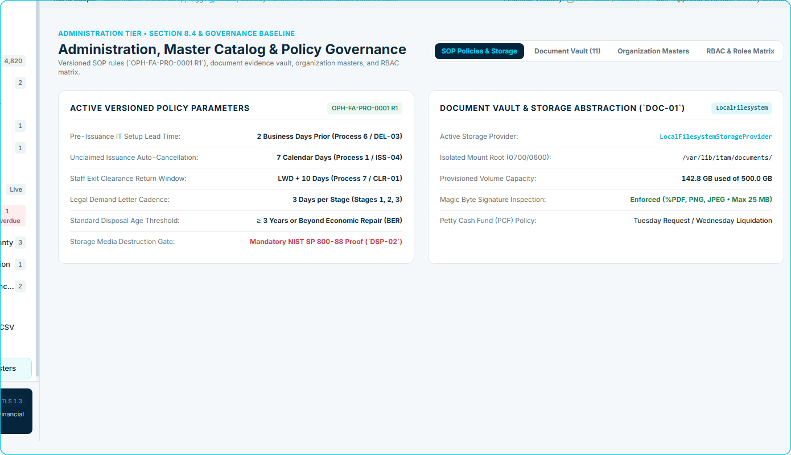
   
  <em>Figure 6: Administration & Policy Console — SOP Rules OPH-FA-PRO-0001 R1, Document Vault & RBAC Matrix — <a href="file:///f:/Outsourced-IT/Sample%20Outsourced%20ITAM/screenshots/admin.png">View Full Console</a></em>

- **Visual Display**: The 6 security pillars:
  - `Identity & Access`
  - `Independent Approvals`
  - `Evidence Protection`
  - `Data Integrity`
  - `Operational Security`
  - `Privacy by Design`
  - **Footer Banner**: `Enforced in Demo Platform: Operationalized via Administration & Policy Console — Versioned SOP OPH-FA-PRO-0001 R1 Rules, Document Vault (AAF/CAAF/Gatepass), and RBAC Matrix.`
- **Core Message**: Enterprise-grade security, maker-checker authorization, and financial data masking.

#### Word-for-Word Talk Track:
> "Slide 7 outlines our security and governance framework:
> - **Role-Based Access Control (RBAC)**: We enforce least privilege. IT Staff manage staging and returns; FA Custodians manage inventory; HR oversees clearance; Auditors have read-only access.
> - **Independent Approvals (Maker-Checker)**: A technician who proposes an asset for disposal or scrap **cannot approve their own disposal request**. It must route to a separate VPQS or Finance approver.
> - **Financial Masking**: Equipment purchase prices and book values are masked from general technicians and visible only to authorized Finance officers.
> - **Evidence Vaulting**: All custody forms (AAF, CAAF, Gatepass, Disposal Certificates) are stored with SHA-256 integrity checksums.
> - **Controlled SOP Rules**: Policy timeframes—such as the 2-day staging requirement, 10-day exit clearance, and NIST SP 800-88 sanitization standards—are version-controlled under SOP `OPH-FA-PRO-0001 R1`."

*Transition*: *"A critical architectural question is how this platform interacts with HubSpot, NetSuite, and HR."*

---

### Slide 8 — 07 / System Landscape (Connecting Without Replacing)

#### Product Visual Preview:

  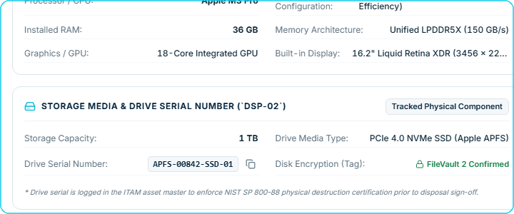
   
  <em>Figure 7: Slide 8 Inset — External System Boundaries ('EXT-01') Drawer Card (HubSpot & NetSuite Demarcation)</em>

- **Visual Display**: Central architecture diagram featuring Outsourced ITAM with the live `EXTERNAL SYSTEM BOUNDARIES ('EXT-01')` card embedded directly from the Asset Detail Drawer.
- **Core Message**: Outsourced ITAM is the physical operational asset and custody layer. It complements rather than displaces existing enterprise platforms.

#### Clear System Boundaries:
- **HubSpot**: Authoritative for client service tickets, onboarding requests, and employee communication.
- **NetSuite**: Authoritative for capital assets, depreciation schedules, and financial GL entries.
- **HR Source**: Authoritative for employee identity, employment status, and official Last Working Day (LWD).
- **Stock Control Hub**: Authoritative source for approved ITAM SOPs, policies, and templates.

#### Word-for-Word Talk Track:
> "A key message for our IT leadership and enterprise architects: **Outsourced ITAM is NOT designed to replace HubSpot, NetSuite, or our HR systems.**
>
> We believe in clear system boundaries (`EXT-01`):
> - **HubSpot** remains the authoritative system for customer requests and IT helpdesk tickets. ITAM references the ticket ID (`#HS-88412`), but a closed ticket does not equal verified asset custody.
> - **NetSuite** remains the financial Fixed Asset Register and General Ledger. Book depreciation, capital expenditure, and GL entries stay in NetSuite. ITAM manages the physical serial number, physical condition, and operational custodian.
> - **HR Source** remains the authoritative master for employee status and employment dates.
> - **Stock Control Hub** remains the policy authority for approved SOPs.
>
> Notice the screenshot embedded in the center: this is the exact **External System Boundaries** card from our Asset Drawer. It displays the HubSpot ticket reference, flags NetSuite Fixed Assets as restricted, and masks acquisition costs for non-finance users."

*Transition*: *"Let's review our phased, dependency-led rollout plan."*

---

### Slide 9 — 08 / Delivery Approach (Controlled Increments)
- **Visual Display**: The 6-stage delivery roadmap (`01 Foundation` → `02 Identity` → `03 Core Records` → `04 Lifecycle` → `05 Control` → `06 Operations`) and the Pilot Gate checklist.
- **Core Message**: An 18-phase dependency-led roadmap reducing risk through verified checkpoints.

#### The 6 Delivery Phases:
1. **Foundation**: Database schemas, audit tables, and encrypted document storage.
2. **Identity & Masters**: Corporate SSO integration, RBAC matrix, and site definitions.
3. **Core Records**: Asset registry, serialized QR code generation, and Document Vault.
4. **Lifecycle Workflows**: Intake, 2-day staging gate, issuance, returns, and inter-site transfers.
5. **Control & Compliance**: Mobile QR audits, maintenance tracking, and NIST disposal gates.
6. **Operations & Governance**: Dashboards, CSV ingestion staging, and reporting.

#### Word-for-Word Talk Track:
> "Slide 9 presents our delivery approach. We will not take a high-risk 'big bang' deployment approach.
>
> Based on our 18-phase implementation plan, we deliver in six controlled increments:
> 1. **Foundation**: Database schemas, audit tables, and encrypted document storage.
> 2. **Identity & Masters**: Corporate SSO integration, RBAC matrix, and site definitions.
> 3. **Core Records**: Asset registry, serialized QR code generation, and Document Vault.
> 4. **Lifecycle Workflows**: Intake, 2-day staging gate, issuance, returns, and inter-site transfers.
> 5. **Control & Compliance**: Mobile QR audits, maintenance tracking, and NIST disposal gates.
> 6. **Operations & Governance**: Dashboards, CSV ingestion staging, and reporting.
>
> Before going live with any department, we must pass the **Pilot Gate**: corporate SSO verified, maker-checker authorization tested, data reconciliation signed off, and disaster recovery backup restores proven."

*Transition*: *"Now, let me show you how we will walk stakeholders through a 7-minute live demonstration."*

---

### Slide 10 — 09 / Suggested Internal Demo Walkthrough

#### Product Visual Preview:

  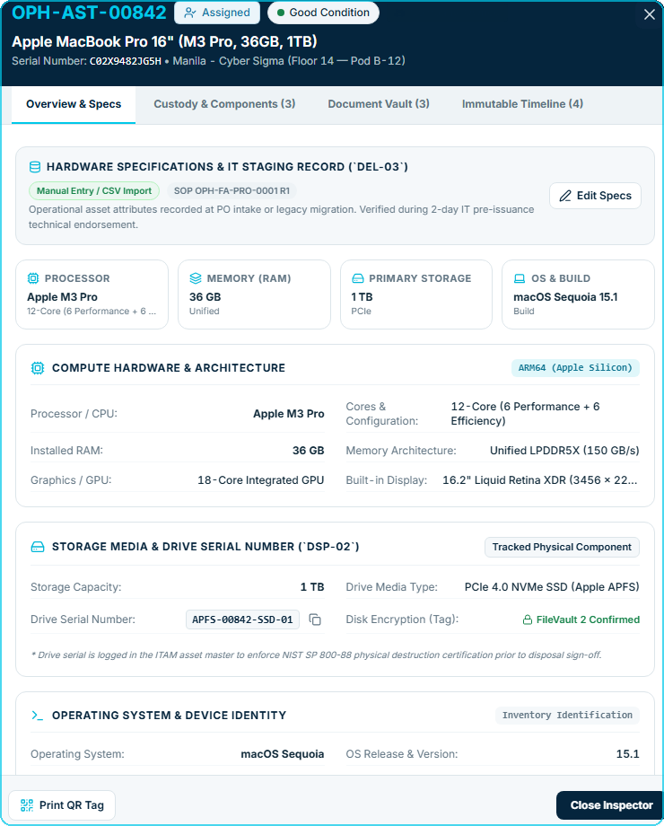
   
  <em>Figure 8: Slide 10 Inset — Complete Asset Custody & Specs Drawer (MacBook Pro 16", OPH-AST-00842) — <a href="file:///f:/Outsourced-IT/Sample%20Outsourced%20ITAM/screenshots/asset_detail.png">View Full Asset Drawer</a></em>

- **Visual Display**: The 6-step walkthrough flow on the left, the real **Asset Detail Drawer** (`s10_asset_drawer.png` showing MacBook Pro 16", hardware configuration, drive serial, custody, and timeline) on the right, and stakeholder decision checklist below.
  - **Footer Status**: `Demo Platform Status: Fully interactive frontend prototype ready for internal IT team and leadership walkthrough.`
- **Core Message**: Recommends demonstrating the platform by telling the real-world story of one asset rather than a disconnected feature tour.

#### The 6-Step Asset Story:
1. **Find**: Global `Ctrl+K` search by tag, serial, or employee name.
2. **Inspect**: Slide-over drawer reviewing hardware specs, drive serial for NIST SP 800-88, location, and NetSuite boundary card.
3. **Issue**: 2-day pre-issuance setup checklist validation, signed AAF/CAAF attachment, and custody handover.
4. **Move**: Inter-site transfer dispatch and destination receipt acknowledgment.
5. **Audit**: Mobile QR camera scan with instant match/discrepancy feedback.
6. **Govern**: Dynamic RBAC persona switching demonstrating financial GL masking and maker-checker approval controls.

#### Word-for-Word Talk Track:
> "To conclude, Slide 10 outlines our recommended 7-to-10 minute demonstration sequence.
>
> Rather than clicking aimlessly through features, we tell the story of a single asset — in this case, **`OPH-AST-00842`**, an Apple MacBook Pro 16":
> 1. **Find**: Search by tag, serial, or employee from the global `Ctrl+K` command bar.
> 2. **Inspect**: Open the slide-over drawer shown on the right. Review its full hardware configuration (Apple M3 Pro, 36GB RAM, 1TB NVMe with drive serial tracking for NIST sanitization), assigned employee (Marco Reyes), and NetSuite boundary card.
> 3. **Issue**: Demonstrate how an available laptop is staged, endorsed by IT, and issued with an attached signed AAF.
> 4. **Move**: Walk through an inter-site transfer to Cebu and show why receipt confirmation is required before the location updates.
> 5. **Audit**: Demonstrate the mobile QR scanner verifying the asset at Manila Floor 14 Pod B.
> 6. **Govern**: Switch user personas from *FA Custodian* to *Finance Officer* to demonstrate how RBAC instantly reveals or masks acquisition cost data.
>
> Before scheduling the pilot deployment, we will confirm our stakeholder decisions: hosting infrastructure, SSO provider, document retention periods, and pilot participant teams.
>
> Our interactive prototype is live and ready for testing. I'd now like to open the floor to questions and transition to the live system walkthrough."

---

## 3. Live Interactive Demo Walkthrough Guide (Browser)

When transitioning from the PowerPoint deck to the live browser at `http://localhost:3000` (or `http://localhost:4173`), execute this exact script:

---

### Step 1: Executive Dashboard & Urgent Work Queue

  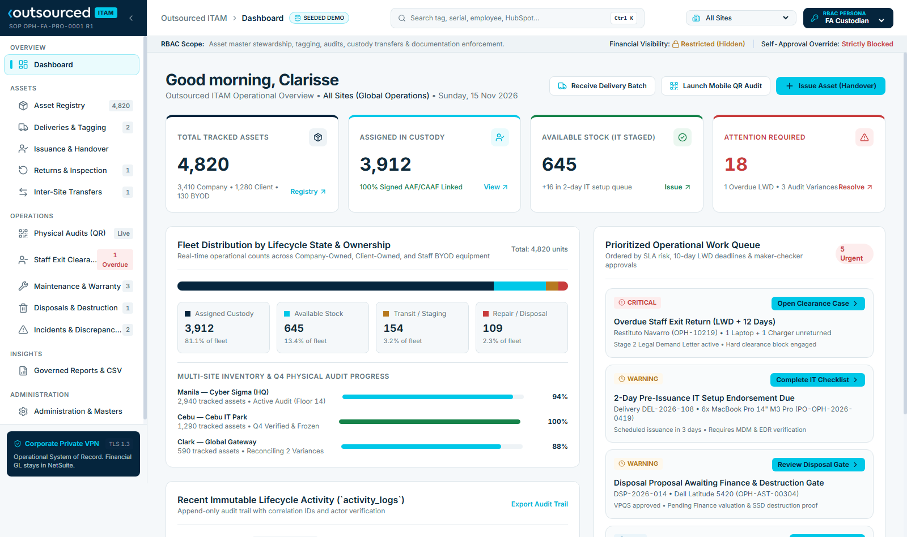

1. Open `http://localhost:3000/?module=dashboard`.
2. Point out the top metric cards: **4,820 Tracked Assets**, **3,912 In Custody**, **645 Available Stock**.
3. Point out the **Prioritized Operational Work Queue** on the right:
   - Highlight the **CRITICAL** item: Restituto Navarro (Offboarding, LWD + 12 Days overdue).
   - Click *"Open Clearance Case"* -> Demonstrates how the system automatically flags the Stage 2 Legal Demand Letter hold and enforces a hard offboarding clearance block with HR.

---

### Step 2: Global Command Search (`Ctrl+K`) & Mobile Search Dismiss

  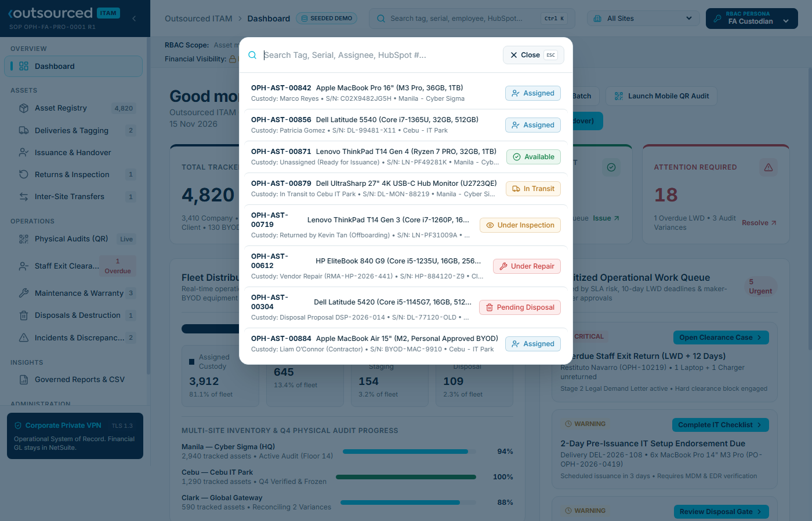

1. Press `Ctrl+K` (or click the search bar in the top header).
2. Type `"842"` -> Notice instant real-time filtering to `OPH-AST-00842` (Apple MacBook Pro 16").
3. Point out the inline `(X)` clear button and the high-contrast `[X Close ESC]` button on both desktop and mobile views.
4. Click the row to trigger the slide-over Asset Detail Drawer.

---

### Step 3: Asset Detail Drawer, Hardware Specs & NetSuite Boundary

  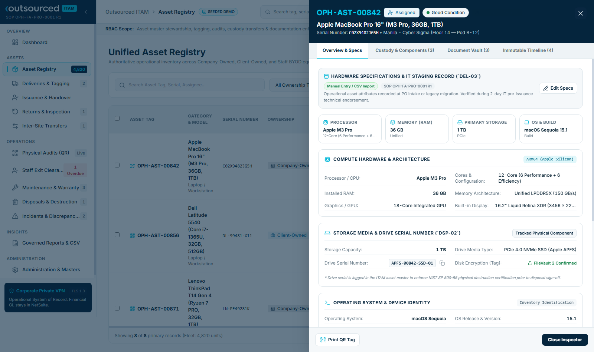

1. **Tab 1: Overview & Specs**:
   - Show detailed Hardware Specifications: Apple M3 Pro 12-core, 36GB Unified Memory, 1TB NVMe SSD.
   - Highlight the **Storage Media & Drive Serial**: `C02X9482JG5H-SSD` (Tracked for NIST SP 800-88 sanitization).
   - Point out the **External System Boundaries ('EXT-01')** card:
     - HubSpot Ticket: `#HS-88412`
     - NetSuite Fixed Asset: `Restricted`
     - Acquisition Cost: `Hidden by RBAC`
2. **Tab 2: Custody & Components**:
   - Show Assignee Marco Reyes (OPH-10492), Seat location Manila Floor 14 Pod B-12.
   - Show linked accessories: 140W USB-C Power Adapter and MagSafe 3 Cable.
3. **Tab 3: Document Vault**:
   - Show verified signed Asset Accountability Form (`AAF-2026-00842.pdf`) with SHA-256 hash badge.
4. **Tab 4: Immutable Timeline**:
   - Review append-only audit entries from PO intake to current custody.

---

### Step 4: Unified Asset Registry & Decoupled Filtering

  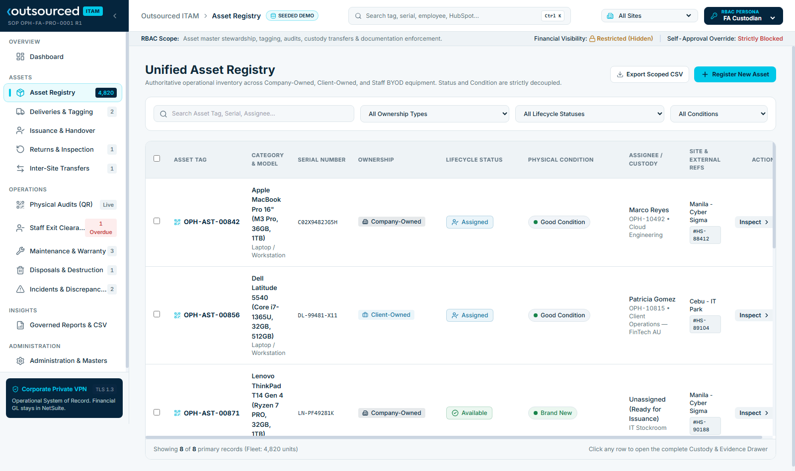

1. Click **Asset Registry** in the left navigation sidebar.
2. Demonstrate **Decoupled Filtering**:
   - Filter Ownership: Select *"Client-Owned (Consigned)"* -> Shows Dell Latitude 5540 assigned to FinTech AU.
   - Filter Status: Select *"Available"* vs *"Under Repair"* vs *"In Transit"*.
   - Notice Condition pills (*Good*, *Fair*, *Defective*) operate independently of operational status.
3. Click *"Export Scoped CSV"* -> Triggers instant CSV export of filtered records.

---

### Step 5: Mobile QR Physical Audit Workspace

  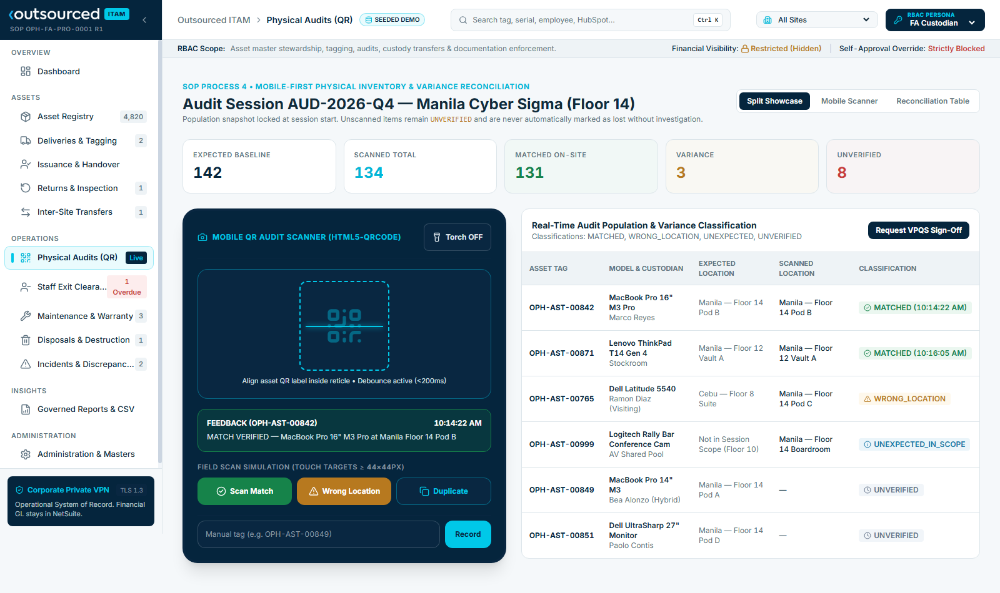

1. Click **Physical Audits (QR)** in the left navigation sidebar.
2. Explain the Q4 Audit Session for Manila Cyber Sigma (Floor 14).
3. Click **"Scan Match"** (simulating a live camera scan of `OPH-AST-00842`):
   - Hear audio confirmation chime.
   - See green feedback banner: *"MATCH VERIFIED — MacBook Pro 16" M3 Pro at Manila Floor 14 Pod B"*.
   - Notice Scanned count increments and Unverified count decrements in real time.
4. Click **"Wrong Location"** (simulating scanning a Cebu asset in Manila):
   - See amber variance alert: *"WRONG LOCATION — Asset expected at Cebu Floor 8, detected at Manila"*.

---

### Step 6: Administration & Governance Console

  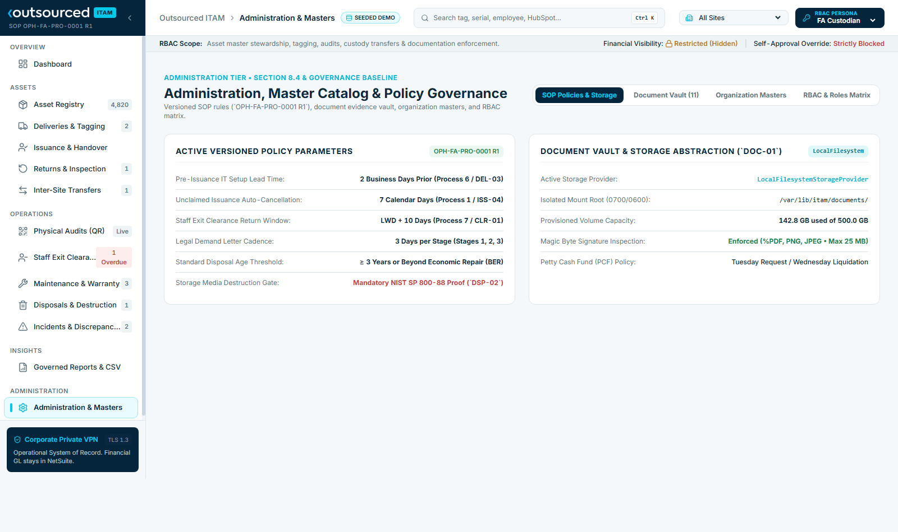

1. Click **Administration & Masters** in the left navigation sidebar.
2. Show **Tab 1 ("SOP Rules Engine")**: View active policy parameters for SOP `OPH-FA-PRO-0001 R1`.
3. Show **Tab 2 ("Document Vault")**: View official templates for AAF, CAAF, Gatepass, and Transmittal.
4. Show **Tab 4 ("RBAC Matrix")**:
   - Highlight that FA Custodians have financial data masked and Maker-Checker override blocked.
   - Go to topbar, switch RBAC Persona to **"Finance Officer"**:
   - Return to the Asset Registry or Drawer -> Notice Acquisition Cost and NetSuite GL data dynamically unmask!

---

## 4. Anticipated Stakeholder Q&A & Bulletproof Responses

### Q1: *"Can an IT technician just edit an asset's serial number or status in the database if there's a typo?"*
> **Answer**:  
> "No. Status transitions and serial updates are protected by transactional business rules. A serial number cannot be duplicated across active inventory. Furthermore, critical transitions—such as moving an asset from `Assigned` to `Disposed`—cannot be performed via a field edit; they must originate from a formal disposal workflow backed by maker-checker approvals and data destruction certificates."

### Q2: *"How does this platform differ from our MDM system like Intune or Kandji?"*
> **Answer**:  
> "MDM systems are device management agents; they manage software configuration, device profiles, and OS updates over the network. They do not manage physical asset custody, vendor purchase orders, signed employee accountability forms (AAF/CAAF), inter-site gatepasses, or physical room audits. Outsourced ITAM is the **operational custodian system**—it records MDM enrollment status as an inventory specification, but enforces legal and physical custody."

### Q3: *"What happens if an employee leaves the company and refuses to return their laptop?"*
> **Answer**:  
> "Outsourced ITAM tracks a strict 10-day countdown from the employee's Last Working Day (LWD). If Day 10 passes without physical return confirmation from IT, the platform automatically flags the record as critical, engages a hard clearance block with HR, and generates a Stage 2 Legal Demand hold record, ensuring the asset is never silently written off."

### Q4: *"Can staff access this on their mobile devices during warehouse deliveries and audits?"*
> **Answer**:  
> "Yes. The entire platform is built with a responsive mobile-first architecture. It features touch-friendly 40×40px tap targets, off-canvas navigation drawers, in-browser HTML5 camera QR scanning, and fast modal dismiss controls."

### Q5: *"Does this replace our NetSuite Fixed Asset register?"*
> **Answer**:  
> "No. NetSuite remains the authoritative financial General Ledger for book depreciation, balance sheet valuations, and tax schedules. Outsourced ITAM manages the operational custody, location, serial numbers, and physical condition. It references NetSuite Asset IDs, providing operational visibility without altering financial accounting."

---

## 5. Stakeholder Alignment & Pre-Pilot Checklist

Prior to initiating Phase 1 of development, align with the core stakeholder team on the following decisions:

- [ ] **Hosting & Network Boundary**: Confirmation of corporate private network / VPN hosting model.
- [ ] **Corporate Identity Provider (IdP)**: Confirmation of SSO protocol (Okta / Azure AD SAML 2.0 or OIDC).
- [ ] **SOP OPH-FA-PRO-0001 R1 Policy Sign-off**: Final approval on the 2-day IT pre-issuance staging gate, 10-day LWD clearance deadline, and maker-checker approval thresholds.
- [ ] **Legacy Data Migration Ownership**: Identification of current spreadsheet custodians for staged ingestion (`MIG-01`).
- [ ] **Document Retention Policy**: Confirmation of storage duration for signed AAF/CAAF records and NIST destruction proofs.
- [ ] **Pilot Department Selection**: Selection of the first operational unit (e.g. Manila Cyber Sigma IT Stockroom) for Phase 6 pilot testing.
