<p align="center">
  
</p>

<h1 align="center">Outsourced ITAM — Asset Lifecycle & Chain-of-Custody Platform</h1>

<p align="center">
  <strong>Authoritative internal IT operational stewardship, physical asset custody, and multi-site inventory governance platform built to standard operating procedure <code>OPH-FA-PRO-0001 R1</code>.</strong>
</p>

<p align="center">
  <a href="https://github.com/Owais573/outsourced-ITAM-demo"></a>
  
  
  
  
  
</p>

---

## 📌 Executive Summary

**Outsourced ITAM** is an enterprise-grade, front-office operational asset management platform designed to replace fragmented spreadsheets, manual checklists, and scattered email threads with an integrated, auditable custody lifecycle system.

Developed specifically for Outsourced internal IT operations, Fixed Asset (FA) custodians, HR specialists, and executive leadership, the platform manages **4,820 active assets** across three global operating hubs:
- **Manila** — Cyber Sigma (Headquarters & Floor 14 Pods)
- **Cebu** — Cebu IT Park (Shared Operations)
- **Clark** — Global Gateway Logistics Hub

The platform strictly decouples **Operational Lifecycle Status** from **Physical Condition**, partitions assets by **Ownership** (Company-Owned, Client-Consigned, and Staff BYOD), and enforces legally binding physical custody handovers through digitally signed Asset Accountability Forms (AAF/CAAF) stored in a secure document vault.

---

## 🏛️ Architectural Foundation: ITAM vs. MDM

A foundational principle of Outsourced ITAM is the strict demarcation between **Mobile Device Management (MDM)** and **IT Asset Management (ITAM)**:

```
┌────────────────────────────────────────────────────────────────────────────────────────┐
│                        ENTERPRISE SYSTEM BOUNDARIES & DOMAINS                          │
├───────────────────────────────┬────────────────────────────────────────────────────────┤
│ Mobile Device Management      │ IT Asset Management (Outsourced ITAM)                  │
│ (Intune, Kandji, Jamf)        │ (Operational System of Record)                         │
├───────────────────────────────┼────────────────────────────────────────────────────────┤
│ • Remote software execution   │ • Authoritative physical custody & seat location       │
│ • Live telemetry & telemetry  │ • Legal signed accountability forms (AAF / CAAF)       │
│ • OS updates & configuration  │ • PO verification, barcode tagging & QR generation     │
│ • Remote lock & device wipe   │ • 2-Day Pre-Issuance IT Staging Gate (`DEL-03`)         │
│ • Network profiling & Wi-Fi   │ • 10-Day LWD Staff Exit Clearance & Legal Hold Blocks  │
│                               │ • Dual-custodian inter-site transfer receipts          │
│                               │ • In-person physical QR audits & variance ledgers      │
│                               │ • Storage media serial tracking for NIST SP 800-88     │
└───────────────────────────────┴────────────────────────────────────────────────────────┘
```

> [!IMPORTANT]
> **Data Integrity Rule**: All inventory specifications, storage drive serials, and custody assignments in Outsourced ITAM originate from manual inspection, vendor purchase order receipts, legacy spreadsheet ingestion, or signed handovers. The platform records MDM enrollment status as an inventory specification, but never requires an agent daemon on end-user machines.

---

## 🚀 Live Product Walkthrough & Screenshots

### 1. Executive Operational Dashboard
Comprehensive fleet overview showing real-time operational counts across multi-site hubs, the 2-day pre-issuance setup queue, multi-site Q4 audit progress, and an urgent SLA work queue.

<p align="center">
  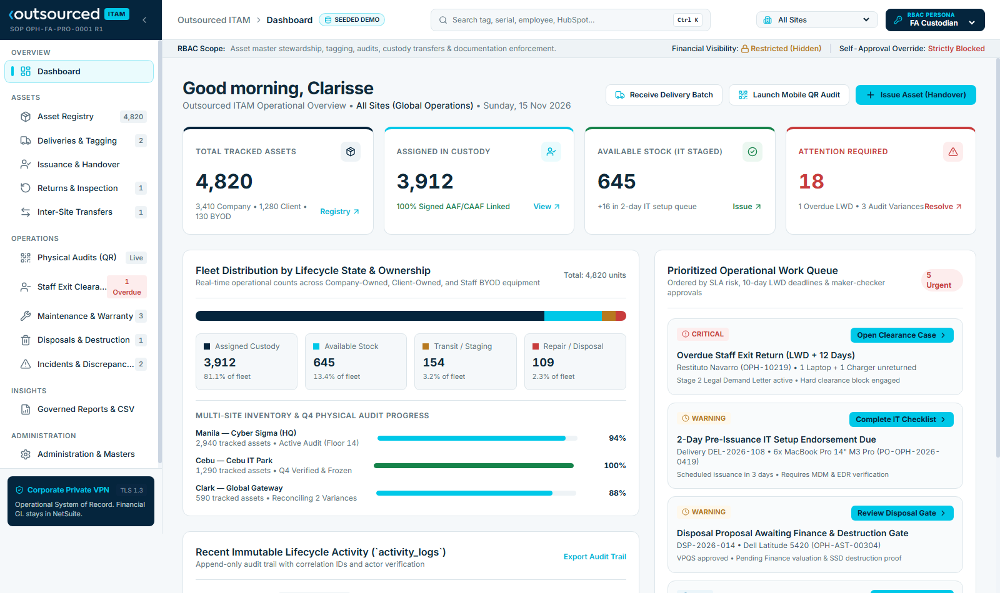
</p>

- **Fleet Distribution**: 4,820 Tracked Assets (3,912 in custody, 645 available, 154 in transit/staging, 109 repair/disposal).
- **Prioritized Operational Work Queue**: Real-time SLA tracking including **Critical Overdue Exit Returns** (Restituto Navarro, LWD + 12 days) with automatic Stage 2 Legal Demand hold triggers.
- **Multi-Site Inventory Progress**: Manila Cyber Sigma (94%), Cebu IT Park (100% verified), Clark Global Gateway (88%).

---

### 2. Unified Asset Registry
The central system of record supporting search, multi-faceted filtering, and decoupled status/condition models.

<p align="center">
  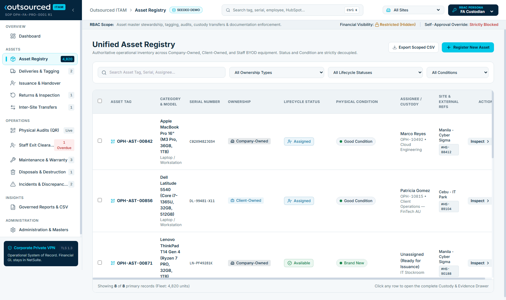
</p>

- **Decoupled Status & Condition**: An asset can be `Assigned` while in `Fair` condition, or `Available` in stock while `Defective`.
- **Ownership Segmentation**: Clear visual badges for `Company-Owned`, `Client-Owned` (Consigned), and `Staff-Owned` (BYOD).
- **External System References**: Direct cross-links to HubSpot onboarding tickets (`#HS-88412`) and NetSuite Fixed Asset numbers.
- **Scoped Export**: Instant governed CSV export honoring active filters and role-based data visibility.

---

### 3. Asset Detail Drawer & Hardware Specifications
Slide-over drawer providing 360-degree custody context and verifiable evidence across four dedicated tabs.

<p align="center">
  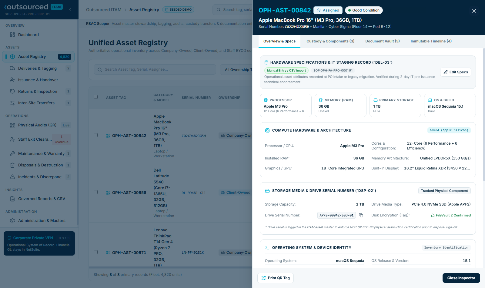
</p>

- **Tab 1: Overview & Specs**:
  - Detailed hardware configuration: Processor, Cores, Memory type, Display resolution, and Hostname.
  - **NIST SP 800-88 Storage Tracking**: Explicit drive capacity, interface type, and drive serial (`C02X9482JG5H-SSD`) required for decommissioning validation.
  - **External System Boundaries (`EXT-01`)**: Displays HubSpot service ticket, flags NetSuite Fixed Asset as restricted, and masks acquisition costs based on RBAC.
  - **"Edit Hardware Specs" Modal**: Full manual spec editor for technicians during physical delivery intake.
- **Tab 2: Custody & Components**: Assigned employee details (`OPH-10492`), exact office seat coordinates (`Manila Cyber Sigma Floor 14 Pod B-12`), and linked accessories (140W USB-C charger, MagSafe cable).
- **Tab 3: Document Vault**: Repository of signed agreements (`AAF-2026-00842.pdf`) with SHA-256 cryptographic verification badges.
- **Tab 4: Immutable Timeline**: Append-only lifecycle activity log showing sequential chain-of-custody transactions.

---

### 4. Deliveries & 2-Day Pre-Issuance IT Staging Gate (`DEL-03`)
Intake workspace for receiving bulk shipments, PO reconciliation, and enforcing the mandatory 2-day pre-issuance staging period before any device can be handed to staff.

<p align="center">
  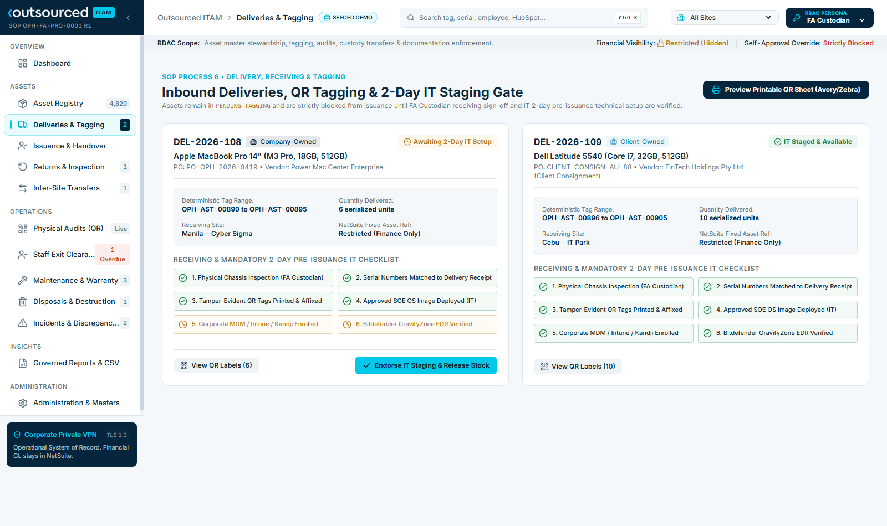
</p>

- **Pre-Issuance IT Endorsement Checklist**: Technicians must endorse SOE image installation, FileVault 2 / BitLocker AES-256 disk encryption, corporate BIOS lock, and Kandji/Intune enrollment before an asset transitions to `Available`.
- **Barcode & QR Generation**: Generates high-resolution printable QR sheets (`OPH-AST-XXXXX`) for physical labeling.

---

### 5. Issuance & Handover Wizard
Guided 5-step operational wizard ensuring no hardware is handed over without physical verification and legal documentation.

<p align="center">
  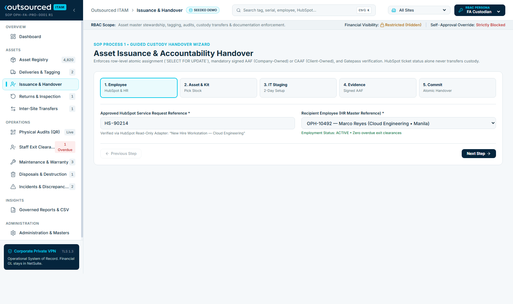
</p>

- **Ownership-Appropriate Agreements**: Automatically links an **AAF** (Asset Accountability Form) for Outsourced equipment or a **CAAF** (Client Asset Acceptance Form) for client-owned devices.
- **Accessory Checklist**: Verifies linked peripherals (chargers, adapters, headsets) alongside the primary computing device.

---

### 6. Staff Exit Clearance & Return Intake (`RET-02` / `OFF-01`)
Coordinated offboarding workspace integrated with HR notices to prevent unreturned hardware and eliminate silent write-offs.

<p align="center">
  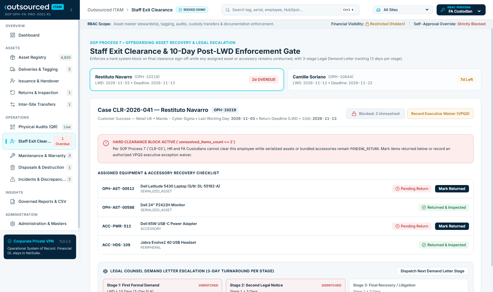
</p>

- **10-Day LWD Countdown**: Automatic tracking from the employee's Last Working Day (LWD).
- **Hard Clearance Blocks**: Automatically freezes HR final clearance if company equipment remains unreturned past the 10-day deadline.
- **Stage 2 Legal Demand Hold**: Activates formal legal recovery holds and document logging for severe delinquency.

---

### 7. Mobile QR Physical Audits & Live Scanner
Mobile-first field inventory verification supporting rapid stockroom and floor audits using device cameras.

<p align="center">
  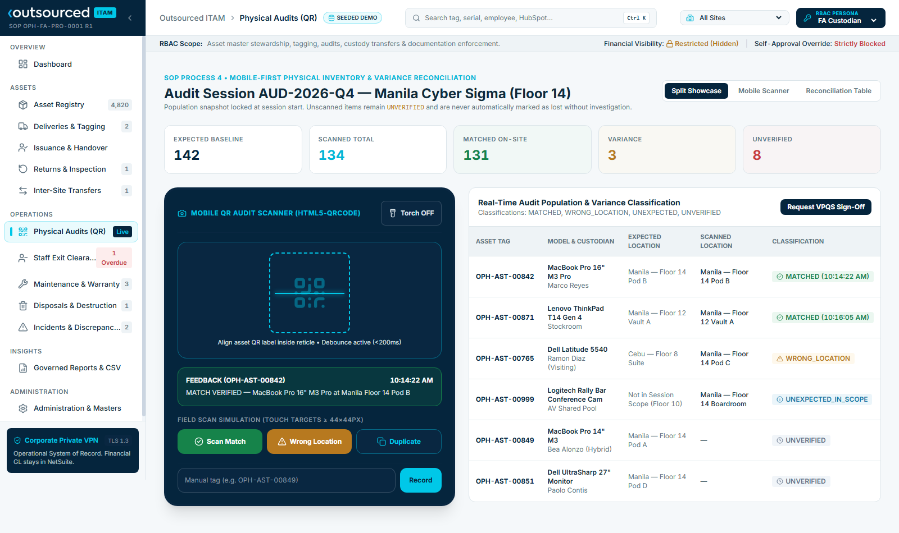
</p>

- **Real-Time Audio-Visual Feedback**:
  - 🟢 **MATCH VERIFIED**: Confirms asset is present in the expected room and custody.
  - 🟡 **WRONG LOCATION**: Highlights assets detected on the wrong floor or site.
  - 🔴 **UNEXPECTED / VARIANCE**: Flags unrecognized serials or unlisted hardware.
- **Reconciliation Table**: Live counter tracking Expected, Scanned, Variances, and Unverified assets.

---

### 8. Administration, SOP Rules Engine & RBAC Matrix
The operational governance hub ensuring all transactions comply with corporate policy and regulatory mandates.

<p align="center">
  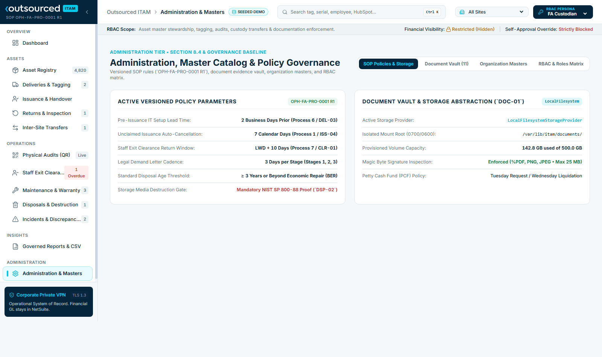
</p>

- **Versioned SOP Rule Engine (`OPH-FA-PRO-0001 R1`)**: Configurable policy thresholds for the 2-day pre-issuance gate, 10-day LWD offboarding deadline, and maker-checker approval chains.
- **Document Vault Templates**: Standardized enterprise templates for AAF, CAAF, Gatepass, Transmittal, and Authority to Scrape (AOL).
- **Interactive RBAC Persona Switcher**: Testable persona switcher in the topbar allowing instant switching between 6 enterprise roles:
  1. `FA_CUSTODIAN` — Clarisse Bautista (Fixed Asset Steward)
  2. `IT_STAFF` — Manuel Santos (Deployment & Setup Technician)
  3. `HR_SPECIALIST` — Alyssa Dizon (People Operations & Offboarding)
  4. `FINANCE_OFFICER` — Roberto Lim (Capex & Depreciation Accountant)
  5. `VPQS_APPROVER` — Ma. Victoria Reyes (Vice President, Quality & Security)
  6. `SYSTEM_ADMIN` — Dev/Admin Superuser
- **Financial Masking & Maker-Checker**: FA Custodians cannot view financial GL costs; technicians cannot approve their own disposal proposals.

---

### 9. Governed Reporting & Legacy Spreadsheet Ingestion (`MIG-01`)
Staged data ingestion console for reconciling and importing legacy Excel asset records safely into the platform.

<p align="center">
  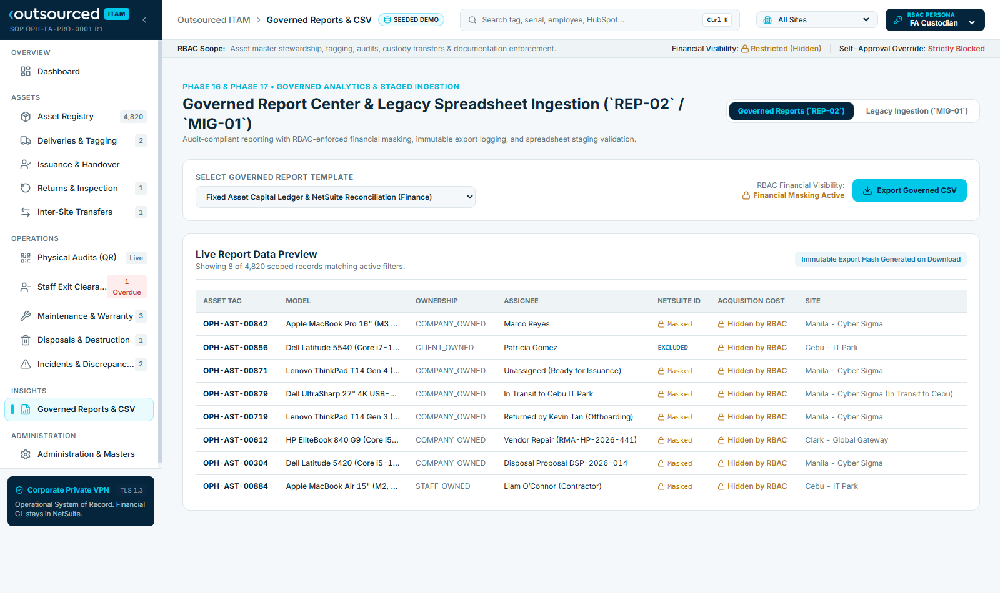
</p>

- **Pre-Ingestion Validation**: Dry-run parsing checks for duplicate serial numbers, unknown site codes, and missing mandatory fields.
- **Governed Defaults**: Imported records safely default to `Available (Staging Queue)` with clean audit trails.

---

## 📱 Mobile-First Responsive Ergonomics

The application is completely optimized for mobile viewports (iPhone, iPad, and Android tablets):
- **40×40px High-Visibility Hamburger Menu Button**: Tactile, high-contrast container with `touch-manipulation` for field technicians.
- **Touch-Friendly Search Dismiss**: Global command modal features an explicit `[X Close ESC]` button and backdrop tap dismiss.
- **Inline Query Reset**: All search inputs include an inline `(X)` clear button.

<p align="center">
  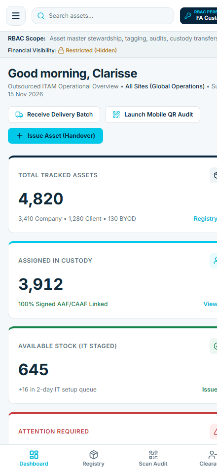
  &nbsp;&nbsp;&nbsp;&nbsp;
  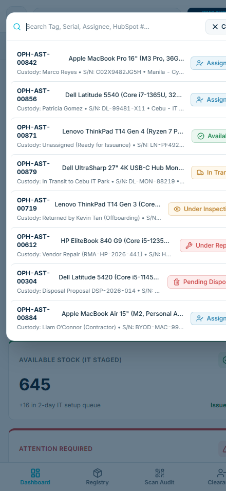
</p>

---

## 📂 Project Structure

```text
├── public/
│   ├── branding/
│   │   ├── favicon.png               # Canonical 274x274 RGBA brand icon
│   │   └── outsourced_logo.webp      # Official Outsourced logo
│   ├── apple-touch-icon.png          # 180x180 iOS touch bookmark icon
│   └── favicon.ico                   # Multi-res (16/32/48/64) Windows icon
├── src/
│   ├── components/
│   │   ├── branding/                 # OutsourcedBrandLogo component
│   │   ├── feedback/                 # Decoupled Status, Condition & Ownership Badges
│   │   ├── layout/                   # Topbar, Sidebar, RbacContextBanner, MobileBottomNav
│   │   └── modals/                   # CommandPaletteModal, PrintableQrModal, DocumentPreviewModal
│   ├── data/
│   │   ├── initialAssets.ts          # Seeded enterprise hardware registry (4,820 fleet subset)
│   │   ├── initialDeliveries.ts      # PO intake batches & IT setup queue data
│   │   ├── initialData.ts            # Clearances, transfers, and Q4 audit session records
│   │   └── roles.ts                  # RBAC personas and multi-site definitions
│   ├── features/
│   │   ├── admin/                    # AdminModule (SOP Rules Engine, Masters, RBAC Matrix)
│   │   ├── assets/                   # AssetRegistryModule, AssetDetailDrawer, AssetConfigurationView
│   │   ├── audits/                   # PhysicalAuditModule (Mobile HTML5 camera scanner)
│   │   ├── clearances/               # ClearancesModule (10-day LWD offboarding & legal holds)
│   │   ├── dashboard/                # DashboardModule (Executive overview & prioritized work queue)
│   │   ├── deliveries/               # DeliveriesModule (2-day pre-issuance staging gate)
│   │   ├── disposals/                # DisposalsModule (Maker-checker approvals & NIST certificates)
│   │   ├── incidents/                # IncidentsModule (Investigation & discrepancy tracking)
│   │   ├── issuance/                 # IssuanceWizardModule (Guided 5-step handover wizard)
│   │   ├── maintenance/              # MaintenanceModule (Vendor RMA & warranty tracking)
│   │   ├── reports/                  # ReportsModule (Governed CSV export & legacy ingestion)
│   │   └── transfers/                # TransfersModule (Dual-custodian inter-site transit)
│   ├── types/
│   │   └── index.ts                  # Comprehensive TypeScript domain interfaces
│   ├── App.tsx                       # Root application shell & routing
│   ├── main.tsx                      # Vite React 18 DOM root
│   └── index.css                     # Tailwind CSS enterprise styles & typography
├── screenshots/                      # High-resolution platform captures & presentation assets
├── index.html                        # Application HTML entry point
├── package.json                      # Dependencies and scripts
├── tsconfig.json                     # TypeScript compiler configuration
├── vite.config.ts                    # Vite build configuration
├── tailwind.config.js                # Tailwind CSS custom palette & typography
├── Outsourced_ITAM_Internal_Product_Showcase.pptx  # 10-slide executive showcase deck
├── PRESENTER_GUIDE.md                # Word-for-word presentation talk track & demo script
└── FRONTEND_IMPLEMENTATION_PLAN.md   # Architectural blueprint & frontend implementation roadmap
```

---

## 🛠️ Technology Stack

| Layer | Technology | Purpose |
| :--- | :--- | :--- |
| **Frontend Framework** | React 18.3 (`react`, `react-dom`) | Declarative, component-based user interface |
| **Build Tooling** | Vite 6.0 (`vite`, `@vitejs/plugin-react`) | Rapid HMR dev server and optimized production bundling |
| **Language** | TypeScript 5.7 | End-to-end domain type safety and strict schema validation |
| **Styling & Design** | Tailwind CSS 3.4 + PostCSS | High-density enterprise design system (Teal/Navy/Cyan) |
| **Iconography** | Lucide React (`lucide-react`) | Clean, accessible SVG iconography |
| **QR Code Scanner** | HTML5-QRCode (`html5-qrcode`) | In-browser camera scanning for physical audits |
| **Utility Libraries** | `clsx`, `tailwind-merge` | Dynamic, conflict-free class name composition |

---

## 🚦 Getting Started

### Prerequisites
- Node.js (v18.x or higher)
- npm or pnpm

### Installation

1. **Clone the repository**:
   ```bash
   git clone https://github.com/Owais573/outsourced-ITAM-demo.git
   cd outsourced-ITAM-demo
   ```

2. **Install dependencies**:
   ```bash
   npm install
   ```

3. **Start the local development server**:
   ```bash
   npm run dev
   ```
   Open your browser at `http://localhost:3000` (or `http://localhost:5173`).

4. **Compile for production**:
   ```bash
   npm run build
   ```
   Compiles TypeScript and creates optimized bundles inside the `dist/` directory.

5. **Preview the production build**:
   ```bash
   npm run preview
   ```

---

## 🧭 Navigation & URL Parameters

The platform supports direct deep-linking to any operational module via URL query parameters:

| URL Parameter | Active Screen | Description |
| :--- | :--- | :--- |
| `/?module=dashboard` | Executive Dashboard | Operational overview, metrics, and work queues |
| `/?module=assets` | Asset Registry | Unified asset inventory table and filters |
| `/?module=assets&asset=OPH-AST-00842` | Asset Detail Drawer | Opens MacBook Pro 16" specs and custody history |
| `/?module=deliveries` | Deliveries & Tagging | PO intake and 2-day pre-issuance staging gate |
| `/?module=issuance` | Issuance Wizard | 5-step guided equipment allocation wizard |
| `/?module=clearances` | Staff Exit Clearance | 10-day LWD offboarding clearance tracker |
| `/?module=transfers` | Inter-Site Transfers | Dual-custodian transit tracking |
| `/?module=audits` | Physical Audits (QR) | Mobile camera QR scanner and variance ledger |
| `/?module=disposals` | Disposals & Retirement | Maker-checker approvals and NIST sanitization |
| `/?module=reports` | Reports & Ingestion | CSV exports and legacy spreadsheet staging |
| `/?module=admin` | Administration & Masters | SOP Rules, Document Vault, and RBAC matrix |
| `/?search=true` | Command Search Modal | Opens global `Ctrl+K` command palette |

---

## 📊 Presentation & Showcase Resources

For presenting this product demo to internal IT leadership, operations directors, and executive management:

- **Executive PowerPoint Presentation**:  
  [Outsourced_ITAM_Internal_Product_Showcase.pptx](./Outsourced_ITAM_Internal_Product_Showcase.pptx)  
  *10-slide widescreen presentation containing live platform screenshots, architecture boundaries, and delivery sequence.*
- **Official Presenter Guide & Talk Track**:  
  [PRESENTER_GUIDE.md](./PRESENTER_GUIDE.md)  
  *Word-for-word talk track, slide-by-slide transitions, 6-step browser demo walkthrough, and anticipated stakeholder Q&A responses.*
- **Architectural & Frontend Implementation Plan**:  
  [FRONTEND_IMPLEMENTATION_PLAN.md](./FRONTEND_IMPLEMENTATION_PLAN.md)  
  *Comprehensive domain model, operational requirements, UI component specifications, and roadmap.*

---

## 📄 License & Governance

Internal proprietary system created for **Outsourced IT Operations**.  
Compliant with Standard Operating Procedure **SOP OPH-FA-PRO-0001 R1**.  
All rights reserved © 2026 Outsourced.
